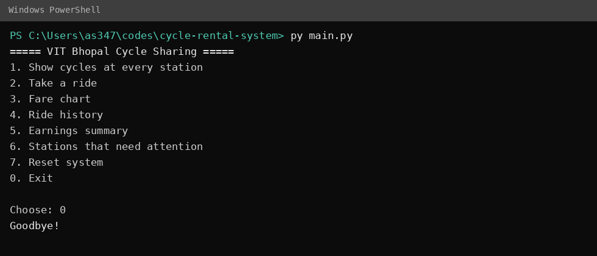
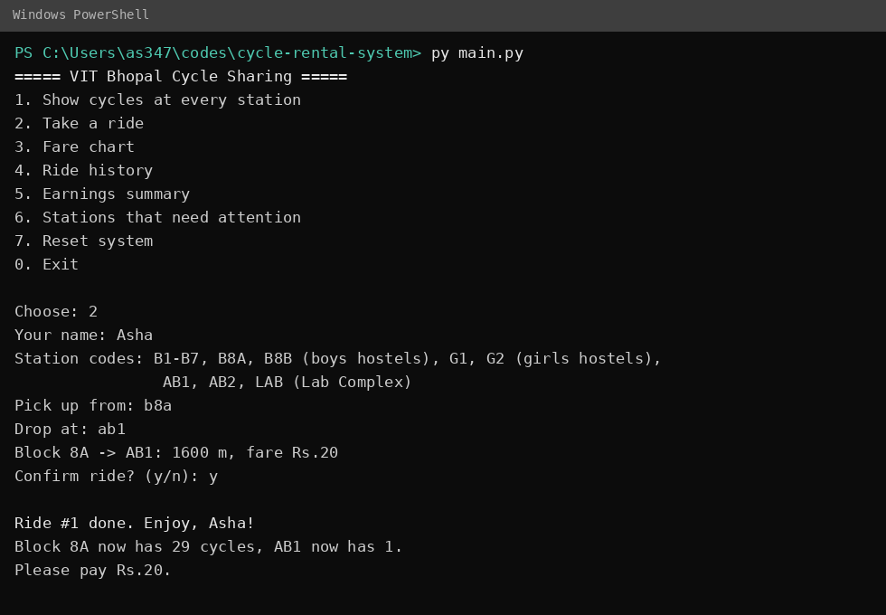
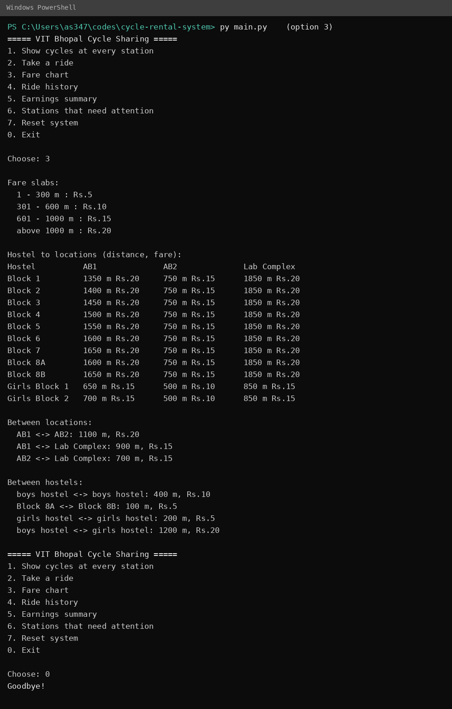
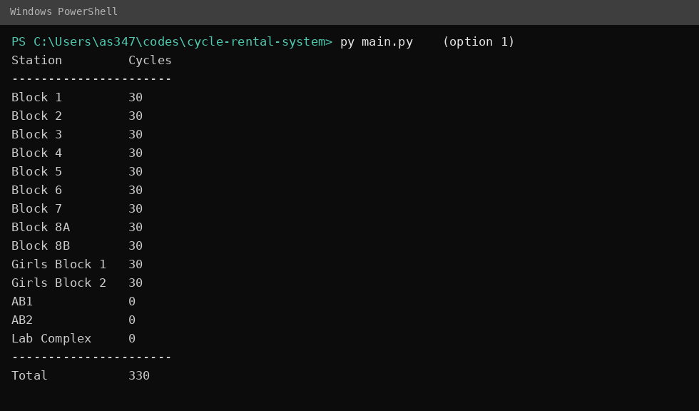
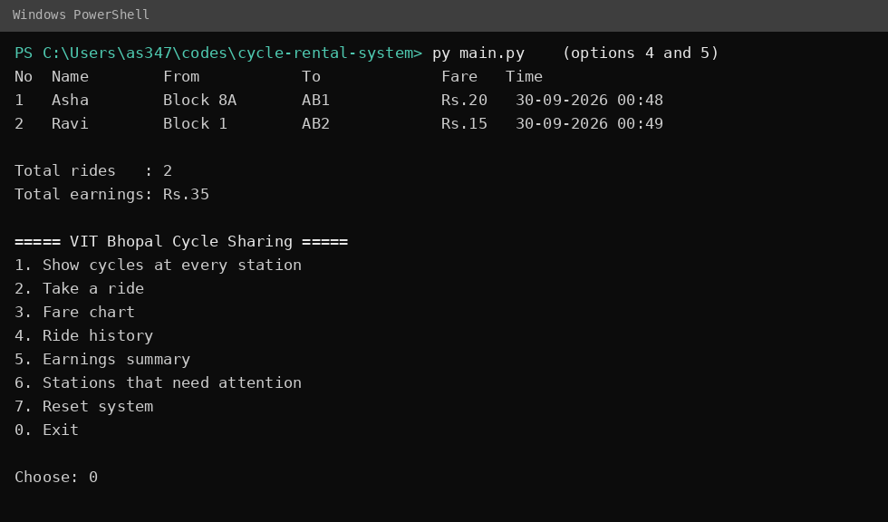
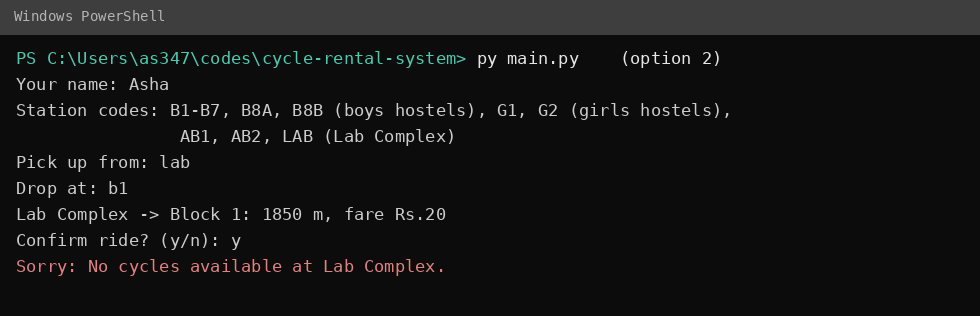
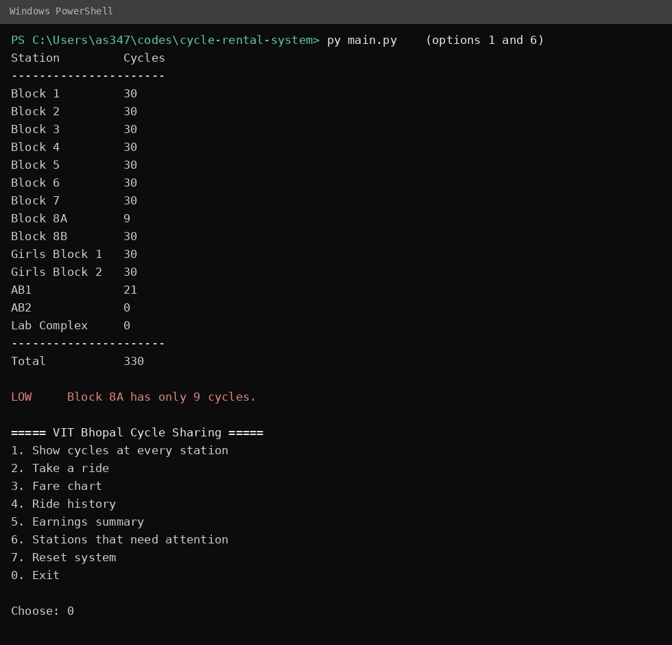
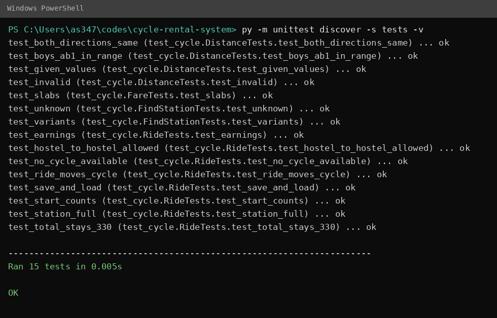

# VIT Bhopal Cycle Sharing System

## Overview

A command-line program that manages a cycle-sharing service for the VIT Bhopal campus. It keeps track of how many cycles are at every hostel and campus location. When a student takes a ride, the cycle count goes down at the pick-up place, goes up at the drop-off place, and the fare is calculated from the distance travelled.

The campus setup used in the program:

| Type | Stations | Starting cycles |
|------|----------|-----------------|
| Boys' hostels | Block 1, 2, 3, 4, 5, 6, 7, 8A, 8B (9 blocks) | 30 each (270) |
| Girls' hostels | Girls Block 1, Girls Block 2 | 30 each (60) |
| Campus locations | AB1, AB2, Lab Complex | 0 each |

Total cycles in the system: **330**. A ride never creates or destroys a cycle, so the total always stays 330.

See `statement.md` for the problem statement, scope and target users.

## Features

- Live cycle count for all 14 stations
- Ride booking with a fare preview and confirmation
- Distance-based fare in four slabs (Rs.5, Rs.10, Rs.15, Rs.20)
- Rides between hostels, from hostels to AB1/AB2/Lab Complex, and back
- Rejects a ride if the pick-up station is empty or the drop-off station is full (60 cycles)
- Ride history and earnings summary
- Report of hostels running low and stations that are crowded
- Station codes for quick typing (`b8a`, `g1`, `lab`)
- Data saved automatically and loaded on the next run, with recovery from a damaged file
- Unit tests

## Technologies / tools used

- Python 3.8 or newer (standard library only: `json`, `os`, `datetime`, `sys`, `unittest`)
- Git and GitHub for version control
- A terminal; no GUI, database or external packages are needed

## Installation and running

### 1. Check that Python is installed

```bash
python --version
```

It should print Python 3.8 or higher. If the command is not found, try `python3 --version` or `py --version` and use that command in place of `python` below. If none works, install Python from https://www.python.org/downloads/ and tick "Add Python to PATH" during installation.

### 2. Get the project

```bash
git clone https://github.com/<github-username>/<repo-name>.git
cd <repo-name>
```

Or download the ZIP from GitHub, extract it, and open a terminal inside the extracted folder.

### 3. Install dependencies

None. The project uses only Python's standard library, so there is no `pip install` step, no virtual environment and no configuration file.

### 4. Run the program

Run the commands from the project folder (the one containing `main.py`).

Interactive menu:

```bash
python main.py
```

Quick demo that runs several sample rides without any typing:

```bash
python main.py --demo
```

## Using the menu

| Option | What it does |
|--------|--------------|
| 1 | Shows how many cycles are at every station |
| 2 | Takes a ride: enter your name, pick-up place and drop-off place, then confirm the fare |
| 3 | Shows the fare slabs and the distance and fare for every route |
| 4 | Shows the ride history |
| 5 | Shows total rides and total earnings |
| 6 | Lists hostels running low (under 10 cycles) and stations that are crowded (over 45) |
| 7 | Resets everything to the starting position |
| 0 | Saves and exits |

Station codes (upper or lower case both work):

| Code | Station |
|------|---------|
| B1 to B7 | Block 1 to Block 7 (typing just `3` also means Block 3) |
| B8A, B8B | Block 8A, Block 8B |
| G1, G2 | Girls Block 1, Girls Block 2 |
| AB1, AB2 | AB1, AB2 |
| LAB | Lab Complex |

Full names such as `Girls Block 1` or `Lab Complex` also work.

Example ride:

```
Your name: Asha
Pick up from: b8a
Drop at: ab1
Block 8A -> AB1: 1600 m, fare Rs.20
Confirm ride? (y/n): y

Ride #1 done. Enjoy, Asha!
Block 8A now has 29 cycles, AB1 now has 1.
Please pay Rs.20.
```

Data is saved automatically to `data/cycle_data.json` after every ride and when you exit, and it is loaded the next time you start. Use option 7 to start fresh.

## Instructions for testing

Run all unit tests from the project folder:

```bash
python -m unittest discover -s tests -v
```

Every test should print `ok` and the run should end with `OK`. The tests cover:

- the fare at the edges of each slab
- the given distances (checked in both directions)
- station-name and station-code parsing
- the starting counts and the total of 330
- a ride moving exactly one cycle, and the total never changing
- rides being rejected when the pick-up station is empty or the drop-off station is full
- earnings, and saving/loading data

For a manual check, run `python main.py --demo`. The last ride in the demo is meant to fail with "No cycles available at Lab Complex."

## Rules

- Students can ride hostel to hostel, hostel to AB1/AB2/Lab Complex, and back from those places to hostels. Rides between AB1, AB2 and the Lab Complex are also allowed.
- A ride can start only if the pick-up place has at least one cycle.
- Taking a cycle reduces the pick-up count by 1 and returning it increases the drop-off count by 1.
- A station can hold at most 60 cycles; a ride to a full station is rejected.

## Fare

| Distance | Fare |
|----------|------|
| 0 - 300 m | Rs.5 |
| 301 - 600 m | Rs.10 |
| 601 - 1000 m | Rs.15 |
| above 1000 m | Rs.20 |

The slabs are defined in `fares.py` and can be changed there without touching any other code.

## Distances

All distances are approximate simulation values, not surveyed measurements. They are stored in `stations.py`.

| Route | Distance |
|-------|----------|
| Boys' hostels to AB1 | 1350 - 1650 m depending on the block |
| Boys' hostels to AB2 | 750 m |
| Boys' hostels to Lab Complex | 1850 m |
| Girls' hostels to AB1 | 650 - 700 m |
| Girls' hostels to AB2 | 500 m |
| Girls' hostels to Lab Complex | 850 m |
| AB1 to AB2 | 1100 m |

These were not part of the given campus data, so simple assumed values are used (they can be changed in `stations.py`):

| Route | Assumed distance |
|-------|------------------|
| AB1 to Lab Complex | 900 m |
| AB2 to Lab Complex | 700 m |
| Boys' hostel to boys' hostel | 400 m (Block 8A to 8B: 100 m) |
| Girls' hostel to girls' hostel | 200 m |
| Boys' hostel to girls' hostel | 1200 m |

## Project structure

```
.
├── main.py          # menu and user input/output
├── stations.py      # station names, codes and distances
├── fares.py         # fare slabs and fare calculation
├── system.py        # CycleSystem class: counts, rides, history, save/load
├── data/            # saved data is written here
├── tests/
│   └── test_cycle.py
├── docs/
│   └── diagrams/    # architecture, use case, workflow, sequence, class diagrams
├── statement.md     # problem statement, scope, target users, features
└── README.md
```

## Screenshots

















## Limitations

- Distances are fixed values in the code, not measured automatically.
- The program tracks how many cycles are at each station, not individual cycle numbers.
- One user at a time (a single terminal session).
